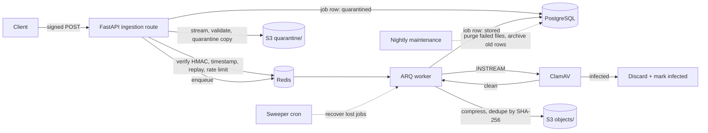

# Secure File Processing Service

An asynchronous file-ingestion service. Uploads are authenticated, quarantined,
virus-scanned, compressed, deduplicated, and stored in S3. Built with Python,
FastAPI, PostgreSQL, Redis, ClamAV, and Docker.

## Architecture



Job states: `quarantined` -> `scanning` -> `clean` -> `storing` -> `stored`,
with `infected` and `failed` as terminal states.

## Results (measured, reproducible)

### Security / load test

`python -m app.loadtest --uploads 1000 --concurrency 50` on a laptop
(Docker Compose, one API process, one worker):

| Measure | Result |
|---|---|
| Uploads sent / accepted | 1000 / 1000 |
| EICAR test files planted / detected | 57 / 57 |
| Malware files stored | **0** |
| Clean files stored | 943 of 943 |
| Burst accepted in | 24.6 s |
| Everything fully processed in | 247 s (median 185 s per job, one worker) |

1,000 uploads a day is roughly one every 86 seconds; this test sends a full
day of volume in minutes. EICAR is a standard antivirus test file: it proves
the scan-and-quarantine pipeline works, not ClamAV's detection rate on
real-world malware.

### Storage reduction

`python -m app.benchmark --corpus <folder>`. Compression-only figures:

| Corpus | Lossy images (WebP q80) | Lossless images |
|---|---|---|
| 17 mixed files (1.43 MB: 4 CSV, 2 JSON, 4 PDF, 4 PNG, 3 TXT) | 43.4% | 26.3% |
| 143 mixed files (17 MB, PDF-heavy) | 35.2% | not run |

Savings depend heavily on the file mix: text, JSON and CSV shrink 50-95%,
images 58-88% (lossy), and PDFs only about 5-11%. Lossy WebP changes image
pixels. Deduplication adds more only when the same file is uploaded repeatedly,
which depends on your traffic, so it is reported separately.
Estimated cost uses an S3 Standard price of $0.023/GB-month, which is a
configurable assumption to check against AWS pricing.

## Features

* HMAC-signed requests with replay protection and per-key rate limits
* Streaming uploads with size, type, and content validation
* ClamAV scanning, failing closed
* Compression: images to WebP, text/CSV/JSON with zstd, PDFs optimised
* Global dedupe by SHA-256
* Archive table, nightly maintenance, index audit, and S3 lifecycle setup
* 207 automated tests against real PostgreSQL, Redis and S3

See [SECURITY.md](SECURITY.md) for the threat model and its limits.

## Quick start

```bash
cp .env.example .env     # then set POSTGRES_PASSWORD and SIGNING_MASTER_SECRET
docker compose up -d --build
docker compose exec api alembic upgrade head
docker compose exec api python -m app.s3setup apply
docker compose exec api python -m app.cli create-key --name demo
```

Upload with the reference client:

```bash
docker compose exec api python -m app.client upload --key <KEY> --secret <SECRET> --file /tmp/photo.png
```

## Tools

| Command | Purpose |
|---|---|
| `python -m app.stats` | live savings from what is actually stored |
| `python -m app.benchmark --corpus DIR` | compression and dedupe benchmark |
| `python -m app.loadtest --key K --secret S` | burst test plus malware verification |
| `python -m app.dbaudit` | confirm every hot query uses an index |
| `python -m app.janitor reconcile` | compare S3 with the database |
| `python -m app.s3setup apply` | bucket hardening and lifecycle rules |

## Tests

```bash
docker compose exec api pytest -q
```

## Limitations

Single-region, no download route, development TLS only, and signature-based
malware detection only. See SECURITY.md.

## License

MIT